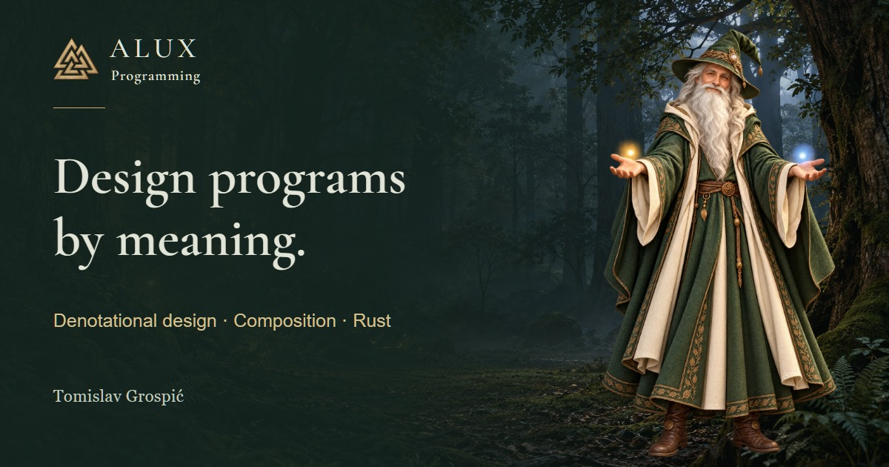

#  ALUX programming guidelines

**English** · [العربية](docs/README.ar.md) · [Deutsch](docs/README.de.md) · [Español](docs/README.es.md) · [日本語](docs/README.ja.md) · [한국어](docs/README.ko.md) · [Русский](docs/README.ru.md) · [Українська](docs/README.uk.md) · [Tiếng Việt](docs/README.vi.md) · [简体中文](docs/README.zh.md) · [繁體中文](docs/README.zh-hant.md)



A book about **designing programs by meaning first** — specifying *what* a program means before deciding *how* it runs — in the style of Conal Elliott's Denotational Design, with a concrete path into Rust.

It provides the foundation for understanding and contributing to ALUX’s meaning-first codebase.

Built with [mdBook] and published to GitHub Pages: <https://alux-network.github.io/alux-programming/>

## What's inside

The book is organized in four parts (full table of contents in [`src/SUMMARY.md`](src/SUMMARY.md)):

- **The Semantic View** — denotations, compositionality, laws and interpretations, dependent types: the meaning-first foundation.
- **Design by Meaning in Rust** — capability algebras, derived meaning and composition, interpreters and effects, laws/scenarios/evidence, first-order programs, compiler pipelines, and a meaning-first workflow.
- **Concepts** — operational semantics, the expression problem, referential transparency, free monads, continuation-passing style, defunctionalization, branching and confluence.
- **Insights** — short essays connecting those concepts back to the semantic view (semantics to machines, the expression problem reloaded, referential transparency reloaded, and the EVM as an algebra).

## Build and run locally

Requires a Rust toolchain (`mdbook-admonish` needs rustc 1.64 or newer) and Node.js 22.18 or newer, which runs the TypeScript translation preprocessor directly. Install mdBook and the preprocessors, pinned to the versions the CI uses:

```sh
cargo install mdbook --version 0.4.52 --locked
cargo install mdbook-admonish --version 1.20.0 --locked
cargo install mdbook-katex --version 0.9.4 --locked
cargo install mdbook-linkcheck --version 0.7.7 --locked
```

Alternatively, open the repository in VS Code with the Dev Containers extension and choose "Reopen in Container". `.devcontainer/` builds an image with Node 24, mdBook and its preprocessors, and the Playwright browsers `npm test` needs; `npm ci` runs on creation and port 3478 is forwarded for `npm start`.

### Reading

The magic world (`/magic/`) has a day/night toggle with daylight as its default. Its entrance detects the first edition by country (falling back to browser language on failure), then remembers the last choice. Localized welcome narration plays only from its button on the entrance and stops on entry into a world. The magic world is a paged book with a fixed-width sidebar. Text size, reading mode, language and normalized progress within each edition's chapter are remembered locally. Folios describe chapter progress. Search is mdBook's own, over the edition's search index, with substring matching for scripts that mdBook's default word tokenizer does not segment (CJK).

### Develop

Install the Node packages once, then start the dev server (opens on <http://localhost:3478>):

```sh
npm install
npm start
```

[Vite] serves the magic world's app from its source in `web/magic/` and everything else from `book/html`: the real world with English at the root and each translation under `/<lang>/`, and the files in `public/` at the root. It waits for every edition before accepting requests, rebuilds when the book's sources (`src/`, `theme/`, `book.toml`) change and reloads the page once the build is done.

To work on one language with mdBook's own faster live reload (without `public/`, so fonts, art and audio are missing):

```sh
MDBOOK_BOOK__LANGUAGE=de mdbook serve --open
```

### Build

Build every edition into `book/html`, the directory CI publishes. mdBook renders each edition twice: as HTML pages (the real world) and as JSON for the magic world (`/magic/data/<lang>.json`, chapter HTML with mdBook's own conventions). Then Vite bundles the magic world's React app into `/magic/` (linking mdBook's stylesheets, highlight.js and search from the build), adds `/real.js` and copies `public/` to the site root:

```sh
npm run build
npm run check    # type-check web/ and vite.config.ts
```

### Test

After `npm run build` (and not while `npm start` is running, since both write `book/html`):

```sh
npx playwright install chromium firefox webkit   # once per Playwright version
npm test
```

- **Site** (`web/test/site.test.ts`): the expected site comes from mdBook's own book for every edition (a renderer, `web/test/book-json.ts`, saves the book mdBook parsed, after the translation preprocessor). Every chapter page must exist in every edition with its `lang`, `dir` and title, no unexpected page may exist, and every link, anchor and asset must resolve. Negative tests check that a missing edition, wrong language or direction, removed or extra page, renamed chapter, broken anchor, missing asset and wrong title are each reported.
- **Translations** (`web/test/translations.test.ts`): every `chapter.<lang>.md` keeps its English chapter's code blocks, math, link targets, embedded media and heading levels.
- **Build** (`web/test/build.test.ts`): two complete mdBook + Vite builds are identical; a failed app bundle preserves the previous site.
- **Browser** (`web/test/browser.test.ts`): the magic world and its entrance on desktop Chromium, Firefox and WebKit, plus iPad Mini/WebKit, Pixel 7/Chromium and iPhone 13/WebKit simulations: edition choice, both world entries, chapter order in every edition, page turns across chapters, RTL keys, remembered position, text size and mode, history, fragments, rendered math and callouts, CJK search, bookmarks, language switching and music. The real world is mdBook's own page, covered by the site test. Missing engines fail the run. Set `ALUX_BROWSER_PROFILE` to a name from the profile list in that test file to diagnose just that profile.

The site must be served from the server root, because the files in `public/` are linked from it (`/wizard-standing.webp`, `/audio/…`).

## Translations

English chapters and `src/SUMMARY.md` are canonical. A translation lives next to its chapter as `chapter.<lang>.md` (`ar de es ja ko ru uk vi zh zh-hant`); a missing translation falls back to English. `web/localize.ts` is the mdBook preprocessor that swaps the sources in for the edition's `book.language`.

A translation starts with a metadata comment:

```html
<!-- reader: {"title":"…","parts":{"Welcome":"…"},"sourceHash":"sha256:…"} -->
```

`title` names the chapter, `parts` (in `index.<lang>.md` only) names the part titles, and `sourceHash` fingerprints the English chapter the translation was reviewed against. When the English chapter changes, the build prints `translation may be stale` with the new fingerprint; review the translation, then set `sourceHash` to it.

UI labels for each language are in `web/i18n.ts`, keyed by the English label. To add a language, add it to `web/languages.ts` (the build, the language picker and the tests read it) and its labels to `web/i18n.ts`, plus `public/audio/welcome/<lang>.mp3` and `public/social/alux-programming-<lang>.jpg`.

Localized repository introductions live in `docs/README.<lang>.md` and are linked from this README. They share the book scope, reader behavior and contributor credits; build instructions stay here. Social cards use the same language codes and are rendered from `web/social-cards.ts` with `node web/social-cards.ts` (requires Playwright Chromium), retaining the original artwork and native 1200 × 630 layout.

## Reader

The book has two worlds, chosen at the entrance (`/magic/<lang>/`):

- **Real world:** mdBook's own site, unchanged except that the header title links to the entrance.
- **Magic world:** a React app at `/magic/<lang>/<chapter>.html` that reads the edition's book JSON and shows it as a bound two-page volume, in mdBook's page structure styled by mdBook's stylesheets and `web/magic/reader.css`. CSS columns lay the chapter out as pages; arrow keys, Page Up/Down, Space and the buttons below the book turn a spread with a soft paper fold (StPageFlip), and turning past the last page folds into the next chapter. Callouts, math and code are rendered by mdbook-admonish, mdbook-katex and mdBook's highlight.js, as in the real world.

Text size, bookmarks, reading music and the language picker are in the magic world's toolbar and sidebar. Preferences and bookmarks are stored in the browser (`localStorage`).

## Repository layout

```
src/            book content (Markdown), with SUMMARY.md as the table of contents
src/**/*.<lang>.md  translations, next to their English chapter
theme/          head.hbs (loads /real.js), CSS, favicons, mdbook-admonish assets
web/            TypeScript: languages.ts, i18n.ts, localize.ts (translation preprocessor), magic-book.ts (JSON renderer), mdbook.ts (builds every edition), real.ts
web/magic/      the magic world's React app: main.tsx (routes), Gateway.tsx, Reader.tsx (markup), chapter.ts (paging and folds), reader.css
web/test/       site, translation, build and browser tests (`npm test`)
public/         images, fonts, art, audio and social cards, copied once to the site root
vite.config.ts  build: mdBook editions, then the magic app and /real.js; dev server with rebuild and reload
book.toml       mdBook config: preprocessors (localize, admonish, katex), linkcheck, HTML output
.github/        CI workflow that builds and publishes the book
book/           generated output (git-ignored)
```

## Conventions

- **Callouts** — [mdbook-admonish] fenced blocks in the `note` / `tip` / `warning` / `quote` styles, each with an optional `title`.
- **Math** — KaTeX via [mdbook-katex], written with `$…$` (inline) and `$$…$$` (display).
- **Links** — `mdbook-linkcheck` runs as part of the build, so cross-links must resolve. Register each new page in [`src/SUMMARY.md`](src/SUMMARY.md).

## Publishing

On every push to `master`, GitHub Actions ([`.github/workflows/deploy.yml`](.github/workflows/deploy.yml)) runs `npm ci`, `npm run check`, `npm run build` and `npm test`, and publishes `book/html` to the `github-pages` branch. Pull requests targeting `master` or `npm-ws`, and pushes to `fix/**`, run the same checks without publishing. CI installs all three Playwright engines and their system dependencies; only pushes to `master` publish.

## Contributors

[Tomislav Grospić (@tgrospic)](https://github.com/tgrospic) authored the book's original content, built the initial website, and refactored the site's mdBook-based architecture and build pipeline.

[Shixi Lin (@shixi-11)](https://github.com/shixi-11) designed the website's interface and contributed to the development of its multilingual reading features, cross-browser testing, and compatibility improvements.

## Status and license

The book is pre-release and evolving alongside ALUX. Licensing follows the ALUX project; a license file will be added when the project is open-sourced.

[mdBook]: https://rust-lang.github.io/mdBook/
[mdbook-admonish]: https://tommilligan.github.io/mdbook-admonish/
[mdbook-katex]: https://github.com/lzanini/mdbook-katex
[Vite]: https://vite.dev/
