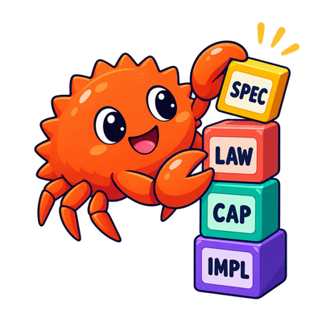

<!-- reader: {"title":"Các đại số năng lực","sourceHash":"sha256:707e5f96df94e673ccee892af8ce5f089dc44abc2d5361d5888348db72d22664"} -->

# Các đại số năng lực {#capability-algebras}



```admonish tip title="Liên quan"
Góc nhìn ngữ nghĩa: [Thiết kế theo ngữ nghĩa](../denotational-design/design.md), [Ngữ nghĩa và tính hợp thành](../denotational-design/denotations.md)  
Thiết kế theo ngữ nghĩa trong Rust: [Kiểu ngữ nghĩa trong Rust](semantic-types.md), [Ý nghĩa suy ra và phép hợp thành](derived-meaning.md)  
Khái niệm: [Bài toán biểu thức](../concepts/expression-problem.md), [Phân nhánh và hội tụ](../concepts/branching.md)
```

```admonish note title="Định hướng"
Đặc trưng năng lực là một đại số nhỏ: nó nêu tên các quan sát và phép biến đổi nguyên thủy mà ý nghĩa cần, đồng thời để bộ diễn giải quyết định cách biểu diễn. Hãy thiết kế từ vựng dựa trên ý nghĩa, không dựa vào các trường mà cách triển khai đầu tiên tình cờ lưu giữ.
```

Rust không có cấu trúc dựng sẵn tên là “Thiết kế theo ngữ nghĩa”. Ta mã hóa từ vựng ngữ nghĩa bằng các tính năng ngôn ngữ thông thường. Đặc trưng năng lực nhỏ là một cách mã hóa hữu ích.

Hậu tố `Alg` trong cuốn sách này có nghĩa là **đại số**: một tập hợp phép toán nguyên thủy nhất quán trên các đối tượng mang do bộ diễn giải chọn.

## Bắt đầu từ ý nghĩa {#start-from-meaning}

Ý nghĩa vị trí nhánh từ phần trước có thể biểu đạt như sau:

```rust,noplayground
#[derive(Clone, Copy, Debug, PartialEq, Eq)]
pub enum Direction {
    Left,
    Right,
}

pub trait BranchAlg {
    type Branch;

    fn branch_root(&self) -> Self::Branch;
    fn branch_grow(&self, branch: &Self::Branch, direction: Direction) -> Self::Branch;
    fn branch_path(&self, ancestor: &Self::Branch, descendant: &Self::Branch) -> Option<Vec<Direction>>;
}
```

Đặc trưng nêu ba ý nghĩa nguyên thủy:

*   tạo vị trí gốc
*   mở rộng nhánh theo một hướng
*   quan sát đường đi tương đối khi nó tồn tại

Đặc trưng không tiết lộ nơi lưu trữ nhánh hay cách mã hóa đường đi.

## Năng lực không phải phép chiếu trường {#capabilities-are-not-field-projections}

````admonish warning title="Phép chiếu trường không phải năng lực ngữ nghĩa"
Hãy so sánh:

```rust,noplayground
trait BranchContext {
    fn branches(&self) -> &Vec<Vec<bool>>;
    fn branches_mut(&mut self) -> &mut Vec<Vec<bool>>;
}
```

Đặc trưng này che giấu cấu trúc phía sau các phương thức nhưng vẫn phơi bày cách biểu diễn. Mọi logic suy ra sẽ bị gắn chặt với vectơ, giá trị boolean, quyền sở hữu và chiến lược biến đổi.
````

Năng lực ngữ nghĩa bộc lộ quan sát hoặc phép biến đổi mà ý nghĩa phía sau cần. Hãy tự hỏi:

```admonish question title="Cần hỏi về mọi năng lực"
Nếu cách triển khai dùng cơ sở dữ liệu, số hạng ký hiệu, số nguyên gọn hoặc dịch vụ từ xa, phép toán này còn hợp lý không?
```

Nếu có, phép toán có thể thuộc về năng lực. Nếu bên gọi cần bố cục trường hiện tại thì có lẽ không.

## Mỗi đặc trưng một ý nghĩa nguyên thủy {#one-primitive-meaning-per-trait}

Đặc trưng nhỏ giúp nhìn rõ các phụ thuộc:

```rust,noplayground
pub trait ClockAlg {
    type Instant;

    fn clock_now(&self) -> Self::Instant;
}

pub trait DeadlineAlg<Instant> {
    fn deadline_expired(&self, now: &Instant) -> bool;
}
```

Một phép toán suy ra cần thời điểm và hạn chót có thể yêu cầu cả hai đặc trưng. Nó không cần một `ApplicationContext` chứa ghi nhật ký, lưu trữ, mạng, cấu hình và lập lịch.

“Nhỏ” không có nghĩa là máy móc giới hạn một phương thức. Hãy nhóm các phép toán khi chúng tạo thành một cấu trúc ngữ nghĩa không thể tách rời. Tách chúng khi chúng biểu đạt các ý nghĩa độc lập hoặc cho phép các bộ diễn giải độc lập.

## Kiểu liên kết chọn đối tượng mang {#associated-types-select-carriers}

Dùng kiểu liên kết khi bộ diễn giải quyết định cách biểu diễn:

```rust,noplayground
pub trait SourceAlg {
    type Source;
    type Error;

    fn source_read(&self, name: &str) -> Result<Self::Source, Self::Error>;
}
```

Đừng yêu cầu `String`, `std::io::Error` hay cây cú pháp cụ thể, trừ khi chúng là từ vựng ngữ nghĩa ổn định tại ranh giới này.

Ngược lại, các giá trị ngữ nghĩa cụ thể hoàn toàn phù hợp:

```rust,noplayground
pub enum Severity {
    Warning,
    Error,
}
```

Quy tắc không phải là “làm cho mọi kiểu đều trừu tượng”, mà là “đừng nhầm cơ chế của bộ diễn giải với từ vựng ngữ nghĩa”.

## Đặt ràng buộc ở nơi sử dụng {#put-bounds-where-they-are-used}

Giữ phép toán nguyên thủy không bị ràng buộc bởi những điều nó không cần:

```rust,noplayground
pub trait CandidateAlg {
    type Candidate;

    fn candidates(&self) -> impl Iterator<Item = Self::Candidate>;
}
```

````admonish warning title="Đừng thêm ràng buộc để phòng xa"
Đừng ràng buộc kiểu liên kết chỉ vì một thuật toán tương lai nào đó có thể cần:

```rust,noplayground
pub trait CandidateAlg {
    // not recommended: every interpreter now pays for bounds
    // most operations never use
    type Candidate: Clone + Ord + Hash + Send + Sync;

    fn candidates(&self) -> impl Iterator<Item = Self::Candidate>;
}
```

Phép toán sắp xếp ứng viên có thể yêu cầu `Ord`; phép toán đưa chúng vào tập băm có thể yêu cầu `Hash`.
````

Ràng buộc tại nơi sử dụng giúp ý nghĩa nguyên thủy tái sử dụng được và làm lộ hợp đồng thực sự của hành vi suy ra.

## Hiệu ứng có thể là ý nghĩa nguyên thủy {#effects-can-be-primitive-meaning}

Đặc trưng năng lực không đồng nghĩa với thực thi thuần:

```rust,noplayground
pub trait PublishAlg {
    type Document;
    type Error;

    async fn publish(&self, document: Self::Document) -> Result<(), Self::Error>;
}
```

Xuất bản là một hiệu ứng. Nó vẫn có thể là phép toán ngữ nghĩa nguyên thủy ở ranh giới hiện tại. Bộ diễn giải cụ thể có thể dùng HTTP, hàng đợi, tệp hoặc bộ đệm kiểm thử.

Lớp ngữ nghĩa không nên áp đặt thử lại, quyền sở hữu socket, tạo tác vụ hay nhóm kết nối, trừ khi những khác biệt đó thuộc ý nghĩa dự định.

## Đặt tên cho ranh giới {#naming-the-boundary}

Hãy diễn đạt năng lực từ góc nhìn ngữ nghĩa của bên sử dụng:

| Định hướng theo ý nghĩa | Định hướng theo biểu diễn |
| --- | --- |
| `closed_outcome(slot)` | `get_runtime_map(slot)` |
| `source_read(name)` | `compiler_context().sources().lookup(name)` |
| `branch_path(ancestor, descendant)` | `raw_branch_bits(id)` |

Đặt tên là một phần của thiết kế. Tên mang tính máy móc dễ kéo theo sự phụ thuộc máy móc.

## Các câu hỏi khi duyệt {#review-checks}

*   Đặc trưng có bộc lộ một ý nghĩa nguyên thủy nhất quán không?
*   Một bộ diễn giải độc lập có thể triển khai nó mà không sao chép cách biểu diễn đầu tiên không?
*   Kiểu liên kết chỉ trừu tượng ở nơi bộ diễn giải thực sự được quyền lựa chọn chứ?
*   Các kiểu cụ thể có phải từ vựng ngữ nghĩa ổn định không?
*   Các ràng buộc chỉ xuất hiện khi một phép toán dùng đến chúng chứ?
*   Đặc trưng có tránh trả về trình quản lý, ngữ cảnh và vùng lưu trữ thô không?
